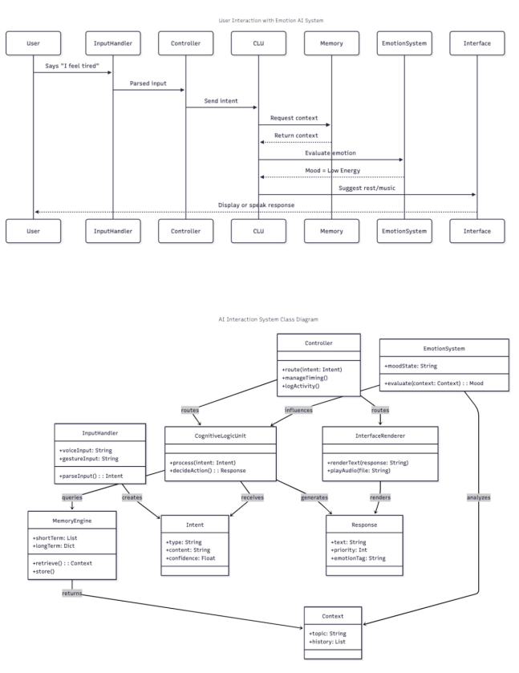

# 🔄 AETHER Runtime Architecture

This document provides a visual and step-by-step walkthrough of how user input is parsed, processed, and transformed into emotionally attuned responses by the MARI-Core system.

---

## 📥 1. User Input

- **Input Example**: "I feel tired"
- Routed through: `InputHandler`
- Action: Parsed into an `Intent` object with confidence scoring

---

## 🔄 2. Controller

- Routes the `Intent` to the appropriate subsystem
- Applies any timing, logging, or safety filters
- Passes intent into Cognitive Logic Unit (CLU)

---

## 🧠 3. CLU – Cognitive Logic Unit

- Decision engine
- Determines if memory or emotion context is needed
- Example Action: `decideAction()` may trigger memory recall

---

## 🧳 4. Mnēsis – Memory Engine

- Retrieves short-term or long-term contextual data
- Sent back to CLU to inform symbolic decision flow

---

## 💗 5. Reverie – Emotion & Motivation System

- Evaluates current mood from memory and input
- Tags as LOW_ENERGY, OVERWHELMED, etc.
- Output routed accordingly

---

## 🖥 6. Interface Render

- The final message or interface element is prepared (text/audio)
- Emotion + priority tags embedded

---

## 🔁 7. MoodGauge Update

- System state is updated (e.g., logs "Tired")
- Prepares for future interactions

---

## 📊 Visual Reference

Refer to the full input-output logic in  
[Aether Input to Output Flow.pdf](./AETHER_User_Input_to_Output_Flow copy.pdf)

