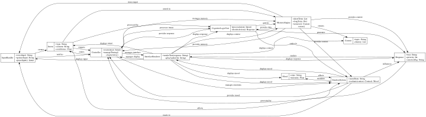

# 🧠 MARI-Core Architecture Reference

This document outlines the structural backbone of AETHER's cognitive-emotional system.

---

## 📐 Class Relationships

- See: Class Diagram (PDF)
- See: Input to Output Sequence (PDF)

+ See: [Class Diagram (PDF)](../mari_class_diagram.pdf)
+ See: [Input to Output Sequence (PDF)](./AETHER_Input_to_Output_Flow.pdf)

---

## 🔄 Interaction Sequence

User input flows through a dynamic, rule-based pipeline that reflects decision logic, memory recall, and emotional modulation.    
    [View Interaction Sequence Diagram](graphviz.svg)
    
 

---

## 🌌 System Modules

| Module | Description |
|--------|-------------|
| **InputHandler** | Parses raw input (voice/text/gesture) into symbolic `Intent` objects |
| **Controller** | Routes intent, applies logic timing, and triggers memory/emotion lookups |
| **CLU (Cognitive Logic Unit)** | Determines next action using symbolic decision logic |
| **MemoryEngine** | Retrieves and stores short/long-term symbolic context |
| **EmotionSystem** | Evaluates mood, assigns `moodState` (e.g., LOW_ENERGY) |
| **InterfaceRenderer** | Renders final output with embedded tone and symbolic markup |
| **ResponseObject** | Final structured message including emotion + priority |

---

## 📊 Visual Companion

For full symbolic walkthrough, read the  
[Runtime Architecture Documentation](./Runtime_Architecture.md)

---

> “Every function here is a metaphor. We don’t just compute — we reflect, remember, and respond.”
